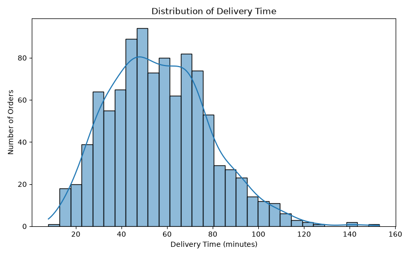
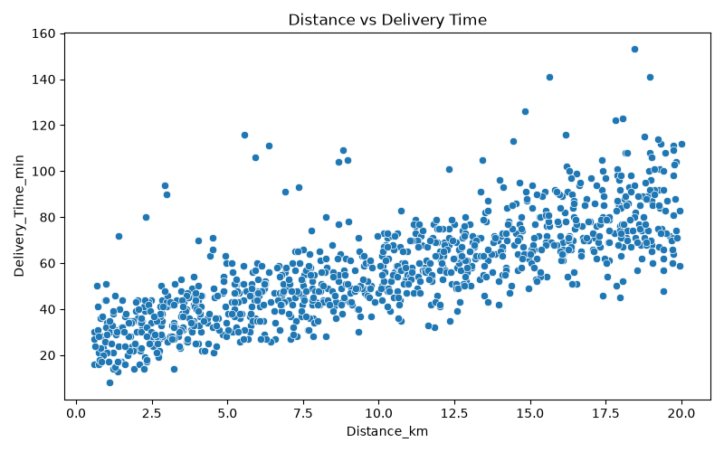
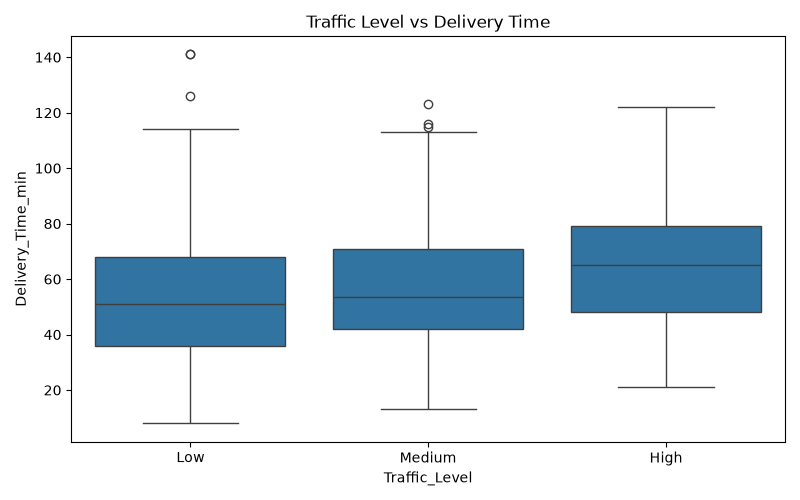
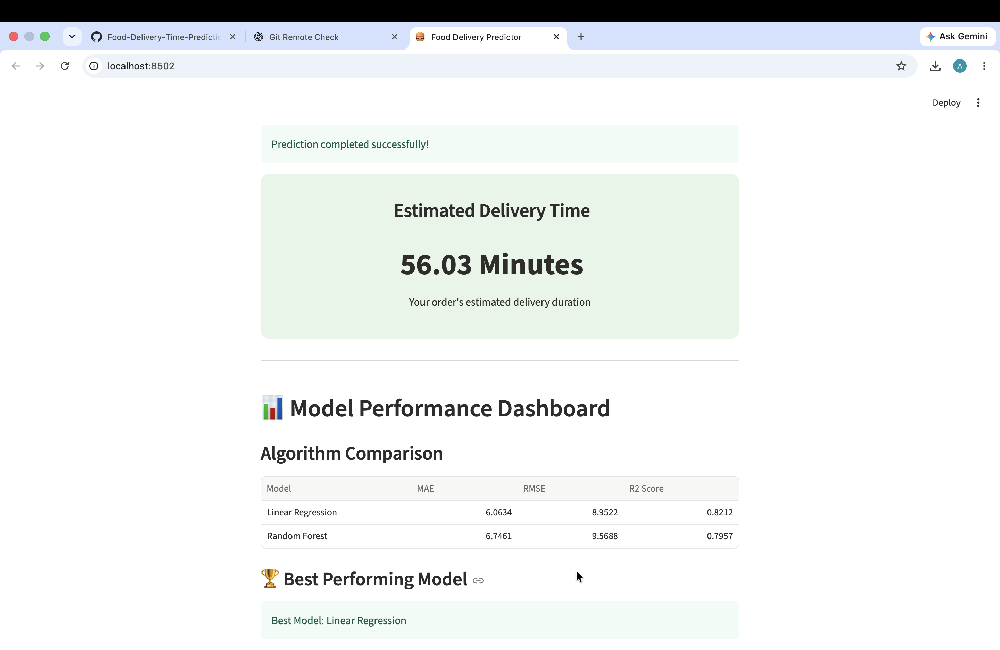

# Food Delivery Time Prediction Using Machine Learning

**AI101 Mini-Project | IIT Ropar**

A Machine Learning project that predicts food delivery time based on delivery distance, weather conditions, traffic conditions, vehicle type, preparation time, and courier experience.

## 1. Project Overview

This project aims to predict food delivery time using regression-based Machine Learning algorithms.

The project involves:

- Data preprocessing and cleaning.
- Exploratory Data Analysis (EDA).
- Training and comparison of regression models.
- Model performance evaluation.
- Development of an interactive prediction application using Streamlit.

## 2. Team Members and Roles

| Team Member         | Entry Number | GitHub Username     | Role               |
| ------------------- | ------------ | ------------------- | ------------------ |
| Aavik               | 2026EEB1313  | @aavikrao           | Execution Lead     |
| Mahak               | 2026MCB1540  | @2026mcb1540-dotcom | Documentation Lead |
| Anghan Divij Krunal | 2026AIB1012  | @Divij0712          | PPT Lead           |
| Nanong Tamut        | 2026DAB1298  | @Nanong10           | Video Lead         |

## 3. Project Structure

```text
Food-Delivery-Time-Prediction/
│
├── Food_Delivery_Times.csv
├── data_preprocessing.py
├── eda.py
├── model_training.py
├── prediction.py
├── main.py
├── app.py
│
├── best_delivery_model.pkl
├── model_results.csv
│
├── delivery_time_distribution.png
├── distance_vs_delivery.png
├── traffic_vs_delivery.png
│
├── app_interface.png
├── prediction_result.png
│
├── requirements.txt
├── README.md
└── .gitignore
```

## 4. Technologies and Libraries Used

- Python 3.14.6
- Pandas
- NumPy
- Matplotlib
- Seaborn
- Scikit-learn
- Streamlit
- Joblib

### Machine Learning Algorithms

1. Linear Regression
2. Random Forest Regression

## 5. Installation and Setup

### Prerequisites

- Python 3.14.6
- Git
- pip

### Step 1: Clone the repository

```bash
git clone https://github.com/aavikrao/Food-Delivery-Time-Prediction.git
```

### Step 2: Navigate to the project directory

```bash
cd Food-Delivery-Time-Prediction
```

### Step 3: Create a virtual environment

```bash
python -m venv .venv
```

### Step 4: Activate the virtual environment

**macOS / Linux:**

```bash
source .venv/bin/activate
```

**Windows:**

```bash
.venv\Scripts\activate
```

### Step 5: Install dependencies

```bash
pip install -r requirements.txt
```

## 6. Steps to Run the Project

### Step 1: Data Preprocessing

```bash
python data_preprocessing.py
```

### Step 2: Exploratory Data Analysis

```bash
python eda.py
```

### Step 3: Train Machine Learning Models

```bash
python model_training.py
```

### Step 4: Run the Prediction Module

```bash
python prediction.py
```

### Step 5: Launch the Streamlit Application

```bash
python -m streamlit run app.py
```

Open the local URL displayed in the terminal to access the interactive application.

**Note:** The trained model and generated files are included in the repository. Verify the execution sequence and dependencies before running all scripts from a fresh clone.

##( Running the Project on Windows )

### Step 1: Clone the Repository

Open Command Prompt or PowerShell and execute:

```bash
git clone https://github.com/aavikrao/Food-Delivery-Time-Prediction.git
cd Food-Delivery-Time-Prediction
```

### Step 2: Check Python Version

```bash
python --version
```

Use Python 3.14.6 for consistency with the project environment.

### Step 3: Create a Virtual Environment

```bash
python -m venv .venv
```

### Step 4: Activate the Virtual Environment

For Command Prompt:

```cmd
.venv\Scripts\activate.bat
```

For PowerShell:

```powershell
.venv\Scripts\Activate.ps1
```

### Step 5: Install Dependencies

```bash
python -m pip install --upgrade pip
pip install -r requirements.txt
```

### Step 6: Verify Installed Libraries

```bash
pip list
```

Ensure that pandas, numpy, matplotlib, seaborn, scikit-learn, streamlit and joblib are installed.

### Step 7: Run Data Preprocessing

```bash
python data_preprocessing.py
```

### Step 8: Run Exploratory Data Analysis

```bash
python eda.py
```

The following output graphs should be generated:

- delivery_time_distribution.png
- distance_vs_delivery.png
- traffic_vs_delivery.png

### Step 9: Train the Machine Learning Models

```bash
python model_training.py
```

Both Linear Regression and Random Forest models should train successfully.

### Step 10: Verify the Saved Model

```bash
dir best_delivery_model.pkl
```

Ensure that the model file exists and is not empty.

### Step 11: Check Model Evaluation Results

```bash
type model_results.csv
```

Verify that MAE, RMSE and R² scores are displayed for both models.

### Step 12: Test the Prediction Module

```bash
python prediction.py
```

Ensure that the prediction module loads the trained model and generates a prediction successfully.

### Step 13: Launch the Streamlit Application

```bash
python -m streamlit run app.py
```

Open the URL displayed in the terminal, usually:

http://localhost:8501

### Step 14: Test the Application

- Enter the delivery distance.
- Select weather conditions.
- Select traffic conditions.
- Choose the time of day.
- Enter courier experience.
- Click the prediction button.
- Verify that the predicted delivery time is displayed in minutes.

### Step 15: Stop the Application

Press `Ctrl + C` in the terminal.

## 7. Model Evaluation and Results

The project uses three performance evaluation metrics:

- **MAE (Mean Absolute Error):** Measures the average absolute difference between actual and predicted delivery times.
- **RMSE (Root Mean Squared Error):** Measures prediction error while penalizing larger errors.
- **R² Score:** Measures how well the model explains variations in delivery time.

### Model Performance Comparison

| Model             |    MAE |   RMSE | R² Score |
| ----------------- | -----: | -----: | -------: |
| Linear Regression | 6.0634 | 8.9522 |   0.8212 |
| Random Forest     | 6.7461 | 9.5688 |   0.7957 |

**Observation:** Linear Regression achieved better performance across all three evaluation metrics in our experiment.

### Exploratory Data Analysis Visualizations

**1. Delivery Time Distribution**



**2. Distance vs Delivery Time**



**3. Traffic vs Delivery Time**



## 8. Expected Output

The Streamlit application allows users to enter delivery-related parameters and obtain an estimated food delivery time.

### 1. Streamlit Application Interface

[Application Interface](./app_interface.png)

### 2. Prediction Result and Model Performance

After clicking the Predict Delivery Time button, the application displays the estimated delivery duration along with the model performance comparison.



## 9. Project Presentation and Links

- **Project Presentation (5 slides):** https://drive.google.com/file/d/1ssxY4Ft2F2s7R_JhpMkNYueY1tUPR3MT/view?usp=drivesdk
- **Project Demonstration Video (maximum 5 minutes):** https://drive.google.com/file/d/1V-Us5de87jgUuIKyetvdiK9DUXpOF4Yt/view?usp=drivesdk
- **Dataset Link:** https://github.com/sanskar770/Delivery_Time_Prediction/blob/main/Food_Delivery_Times.csv?utm_source=chatgpt.com
## 10. AI-Use Disclosure

AI tools were used to assist with project development and documentation.

**ChatGPT:**

- Used for project-related guidance.
- Understanding Machine Learning concepts and algorithms.
- Troubleshooting coding errors.
- Assistance with project documentation and README preparation.

**Verification:**

Python scripts were executed by the team, and generated model evaluation results were checked against the output CSV file.

The team is responsible for understanding, reviewing, testing, and explaining the complete project.

## 11. Future Scope

- Integration of real-time traffic information.
- Use of larger and more diverse datasets.
- Exploration of advanced Machine Learning algorithms.
- Deployment of the Streamlit application online.

---
